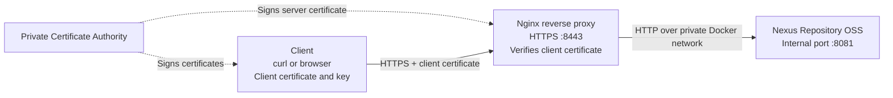

# Nexus Repository OSS with Mutual TLS (mTLS)

A Docker Compose project that runs Sonatype Nexus Repository OSS behind an Nginx reverse proxy and protects access with HTTPS and mutual TLS (mTLS).

## Overview

The project demonstrates how to:

- Run Nexus Repository OSS in Docker.
- Use Nginx as an HTTPS reverse proxy.
- Require clients to present a valid certificate signed by a trusted private Certificate Authority (CA).
- Keep Nexus on an internal Docker network rather than publishing its port directly to the host.
- Store Nexus data in a persistent Docker volume.

## Architecture



The CA certificate is trusted by Nginx for client-certificate verification. Clients use a certificate and its private key to authenticate to Nginx. Nginx then forwards accepted requests to Nexus over the internal Docker network.

An editable copy of the diagram is available at [`docs/architecture.mmd`](docs/architecture.mmd).

## Technology Stack

- Ubuntu Linux
- Docker Engine and Docker Compose
- Sonatype Nexus Repository OSS (`sonatype/nexus3:3.96.3`)
- Nginx (`nginx:1.28-alpine`)
- OpenSSL for certificate management
- TLS 1.2 and TLS 1.3

## Project Structure

```text
nexus-mtls/
├── compose.yaml
├── nginx/
│   └── default.conf
├── docs/
│   └── architecture.mmd
├── screenshots/
└── README.md
```

The `certs/` directory is created locally and is intentionally excluded from Git because it contains certificates and private keys.

## How It Works

1. Docker Compose starts Nexus and Nginx.
2. Nexus listens on port `8081` inside the private Docker network.
3. Nginx listens on container port `443`, published as host port `8443`.
4. Nginx presents its server certificate and requests a client certificate.
5. Nginx verifies the client certificate against the configured CA.
6. Requests with a valid client certificate are proxied to Nexus.

**Important:** mTLS authenticates the client at the TLS layer. It does not replace Nexus user authentication or repository permissions.

## Prerequisites

- Linux with Docker Engine and the Docker Compose plugin.
- OpenSSL.
- Sufficient memory for Nexus Repository.
- A CA certificate, server certificate and private key, and client certificate and private key.

The local certificate files must be present at these paths before starting the stack:

```text
certs/
├── ca/
│   └── ca.crt
├── server/
│   ├── server.crt
│   └── server.key
└── client/
    ├── client.crt
    └── client.key
```

The server certificate must be valid for the IP address or hostname configured in `nginx/default.conf`. The client certificate must be signed by the trusted CA and suitable for client authentication.

## Start the Project

From the project directory, validate the Compose configuration:

```bash
sudo docker compose config -q
```

Start the services:

```bash
sudo docker compose up -d
```

Check their status:

```bash
sudo docker compose ps
```

Follow the logs:

```bash
sudo docker compose logs -f
```

Press `Ctrl+C` to stop following the logs. This does not stop the containers.

## Verify Mutual TLS

The examples below use `192.168.198.140` as the lab VM IP address. Replace it if your VM's address changes, and ensure the server certificate and Nginx configuration match.

### 1. Test with a valid client certificate

Run from the project directory, where the local certificate files are available:

```bash
curl --connect-timeout 10 \
  --cacert certs/ca/ca.crt \
  --cert certs/client/client.crt \
  --key certs/client/client.key \
  -sS -o /dev/null \
  -w 'HTTP status: %{http_code}\n' \
  https://192.168.198.140:8443/
```

An HTTP `200` response confirms that the request reached the Nexus web interface successfully in this lab setup.

### 2. Test without a client certificate

```bash
curl --connect-timeout 5 \
  --cacert certs/ca/ca.crt \
  -v https://192.168.198.140:8443/ \
  -o /dev/null
```

The request should be rejected because no client certificate was provided. Nginx may report the rejection as an HTTP `400` response.

### 3. Confirm Nexus is not published directly

```bash
sudo docker compose ps
```

Nexus should show its internal `8081/tcp` port without a host port mapping. The host-facing entry point is Nginx on port `8443`.

## Screenshots

Screenshots documenting the running containers and verification tests will be added here.

Suggested filenames:

- `01-containers-running.png`
- `02-mtls-success.png`
- `03-mtls-rejection.png`
- `04-nexus-port-security.png`

After uploading the images to the `screenshots/` directory on GitHub, add them to this section using relative Markdown image paths, for example:

```markdown

```

## Security Notes

- Do not commit private keys, including `ca.key`, `server.key`, or `client.key`.
- Do not commit generated certificate material unless there is a specific, safe reason to publish a certificate.
- Never distribute the CA private key to clients.
- Distribute only the client credentials and CA certificate needed by an authorized client, using a secure method.
- Nexus is intended to be accessed through the Nginx mTLS entry point in this configuration.
- Use Nexus accounts, roles, and repository permissions as an additional layer of access control.

## Stop the Project

```bash
sudo docker compose down
```

This stops and removes the containers but preserves the named Nexus data volume.

To remove the data volume as well, you would need to explicitly remove it. Doing so can permanently delete stored Nexus data.

## License

This project is a learning lab. Nexus Repository OSS, Nginx, and other included components remain subject to their respective licenses.
